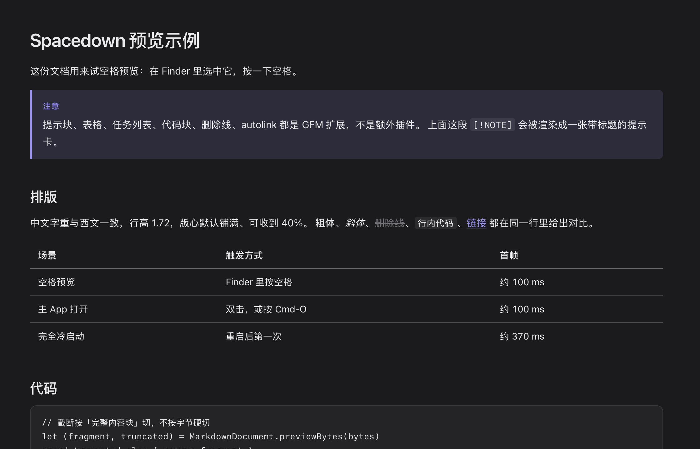

<div align="center">
  
  <h1>Spacedown</h1>
  <p><b>Press space on a Markdown file in Finder — see it rendered.</b></p>
  <p>
    <a href="README.md">简体中文</a> ｜ <b>English</b>
  </p>
  <p>
    macOS 13+ · Apple Silicon · MIT ·
    <a href="https://github.com/Czw96/Spacedown/releases/latest">v1.0.23</a>
  </p>
</div>


## Why

macOS Quick Look treats `.md` as plain text: monospaced font, literal `#`, tables flattened into
pipes. You just want to glance at a document, and you end up opening an editor.

Spacedown takes over that step: select a `.md` in Finder, press space, read typeset content.
Double-click and you get a read-only tabbed window for several documents at once.

## What's good about it

- **Space, and it's there** — no window to open, no network needed.
- **Looks like GitHub** — tables, task lists, code blocks, `> [!NOTE]` callouts, strikethrough.
- **Tabbed, read-only window** — drop files in, they reload when changed, measure and zoom adjustable.
- **Native and small** — a 3 MB Swift + AppKit app that renders through the system WebKit instead of
  shipping a browser framework; first frame usually a couple hundred milliseconds.



## Install

Download the `.dmg` from the [latest release](https://github.com/Czw96/Spacedown/releases/latest),
open it, and drag Spacedown into Applications.

> [!IMPORTANT]
> Two one-time steps after installing: **allow the first launch** in System Settings → Privacy &
> Security (the app is not notarized), then **choose “View → Take over Markdown quick look”** once.
> Without the second step, space still shows source text.
>
> Details (`xattr` to clear quarantine, how to diagnose a failed takeover) are in
> [`docs/构建与发布.md`](docs/构建与发布.md) (Chinese).

## Usage

| Action | Shortcut |
|---|---|
| Open file | <kbd>⌘</kbd><kbd>O</kbd> |
| Close tab | <kbd>⌘</kbd><kbd>W</kbd> |
| Next / previous tab | <kbd>⌃</kbd><kbd>⇥</kbd> / <kbd>⌃</kbd><kbd>⇧</kbd><kbd>⇥</kbd> |
| Jump to tab N | <kbd>⌘</kbd><kbd>1</kbd> … <kbd>⌘</kbd><kbd>9</kbd> |
| Zoom in / out / reset | <kbd>⌘</kbd><kbd>+</kbd> / <kbd>⌘</kbd><kbd>−</kbd> / <kbd>⌘</kbd><kbd>0</kbd> |
| Measure wider / narrower / full | <kbd>⌥</kbd><kbd>⌘</kbd><kbd>=</kbd> / <kbd>⌥</kbd><kbd>⌘</kbd><kbd>−</kbd> / <kbd>⌥</kbd><kbd>⌘</kbd><kbd>0</kbd> |
| Find | <kbd>⌘</kbd><kbd>F</kbd> |
| Reveal in Finder | <kbd>⌘</kbd><kbd>⇧</kbd><kbd>R</kbd> |

Drop a `.md` anywhere in the window to open it; double-click the empty tab bar for a new tab.
Quick Look zooms too, with ⌘+ / ⌘−.

## Known limitations

- Apple Silicon only (no Intel build).
- Read-only: no editing or saving.
- Remote images are never loaded (offline by design), so shields.io badges don’t show in previews.

## FAQ

**Space still shows source?** The takeover didn’t take. Run the menu item again, and make sure no
other Markdown preview extension is competing (WPS does).

**Double-clicking a `.md` doesn’t render?** Use “Set as default .md handler” in Settings.

**Images missing?** Remote images are skipped by design; local images must live under the same
directory as the document.

## Build from source

```bash
python3 scripts/gen_project.py
xcodebuild -project Spacedown.xcodeproj -scheme Spacedown -configuration Release build
```

Installing, claiming Quick Look, releasing and self-update keys are documented in
[`docs/构建与发布.md`](docs/构建与发布.md); architecture and trade-offs in
[`docs/技术方案.md`](docs/技术方案.md) (both Chinese).

## Contributing

Single maintainer. Issues welcome (include your macOS version and a sample file); open an issue
before a PR; docs fixes can go straight in.

## License

[MIT](LICENSE). The renderer [cmark-gfm](https://github.com/github/cmark-gfm) is BSD-2-Clause.

> The code is generated by an AI coding assistant (WorkBuddy); requirements, trade-offs and
> acceptance are the human’s.
