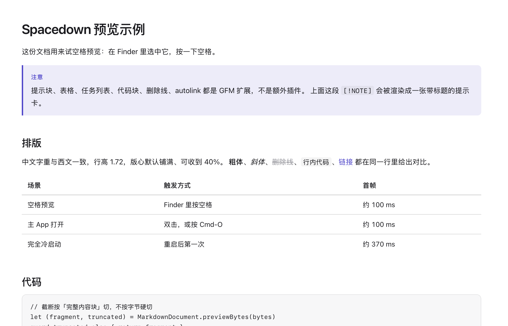

<div align="center">
  
  <h1>Spacedown</h1>
  <p><b>Press space on a Markdown file in Finder — see it rendered.</b><br>
  Native rendering · Quick Look extension · read-only multi-tab viewer</p>

  <p>
    <a href="README.md">简体中文</a> ｜ <b>English</b>
  </p>

  <p>
    macOS 13+ · Apple Silicon · MIT ·
    <a href="https://github.com/Czw96/homebrew-spacedown/releases/latest">v1.0.22</a> ·
    AI-generated code
  </p>
</div>



> [!NOTE]
> **This project is implemented by an AI coding assistant** (code, docs, design and release
> scripts). A human owns requirements, trade-offs and on-device acceptance. See
> [AI disclosure](#ai-disclosure) for the exact split — worth reading before you trust it.

## The problem

macOS Quick Look treats `.md` as **plain text**: monospaced font, literal `#`, tables
flattened into pipes. You just want to glance at a document, and you end up opening an editor.

Spacedown does two things:

1. **Takes over Quick Look for Markdown** — select a `.md` in Finder, press space, get typeset
   content: GFM tables, task lists, strikethrough, autolinks, fenced code, `> [!NOTE]` callouts,
   and relative images inlined.
2. **Ships a read-only multi-tab viewer** — double-click to open, multiple files side by side,
   live reload on external edits, adjustable measure and zoom.

The renderer is vendored [cmark-gfm](https://github.com/github/cmark-gfm) plus a hand-written
HTML shell. **No JavaScript runs in that layer**: no front-end framework, no JS syntax
highlighting, no network access.

## Features

| | |
|---|---|
| **Space to preview** | A Quick Look extension: press space in Finder, get rendered Markdown |
| **Just enough to glance** | Quick Look renders the first 64 KB — cut at a **complete block boundary** so tables and code fences never split — with a "load more" button that hands the file to the app |
| **Tabs** | Custom tab bar, `WKWebView` LRU pool (5 + 2 spare), ~0 ms tab switching; hard cap of 10 tabs |
| **Fast first frame** | A web view is prewarmed at launch: ~100 ms for the first file (the 370 ms cold start is paid during app launch instead) |
| **Read-only, still copyable** | CSP `default-src 'none'`, HTML is not editable; selection, ⌘C and ⌘A work |
| **Live reload** | `DispatchSource` watch + 120 ms debounce + inode/size/mtime comparison; survives delete-and-recreate |
| **Light/dark** | Follows the system appearance, one CSS for both Quick Look and the app |
| **Adjustable measure** | Full width by default, down to 40%; ⌥⌘= / ⌥⌘− / ⌥⌘0 |
| **Zoom** | ⌘+ / ⌘− / ⌘0, 25%–500%, via `pageZoom` (reflows, so no horizontal scrollbar) |
| **Find** | ⌘F opens a find bar using WebKit's native `find`, no injected JS |
| **Links** | Click copies the URL, ⌘/⌃ + click opens it in your browser (via XPC, out of the sandbox) |
| **Self-update** | Ed25519 self-signing plus a swap script — safe upgrades without a Developer ID |


## Install

Requires **macOS 13 Ventura or later** on **Apple Silicon** (arm64 only, no Intel build).

### Homebrew (recommended)

```bash
brew tap czw96/spacedown
brew trust czw96/spacedown            # third-party taps need explicit trust once
brew install --cask spacedown

brew upgrade --cask spacedown         # upgrade
brew uninstall --cask --zap spacedown # uninstall, including preferences and caches
```

### Download

Grab the `.dmg` from the [latest release](https://github.com/Czw96/homebrew-spacedown/releases/latest),
mount it, drag Spacedown into Applications.

### First launch (not notarized)

There is **no Apple Developer ID** here; the build is ad-hoc signed, so Gatekeeper blocks the
first launch:

- Since macOS 15, right-click → Open no longer works;
- use **System Settings → Privacy & Security → Open Anyway**, or
- `xattr -dr com.apple.quarantine /Applications/Spacedown.app`.

### ⚠️ One more step: claim Quick Look

Launch Spacedown once (macOS only registers its extensions after the host app has run), then
choose **View → Take over Markdown quick look** from the menu and wait a few seconds.

**Without this, space still shows source text.** See the next section for why.

You can also make it the default `.md` handler in Settings (<kbd>⌘</kbd><kbd>,</kbd>).

## Using it

| Action | Shortcut |
|---|---|
| Open file… | <kbd>⌘</kbd><kbd>O</kbd> |
| Close tab / window | <kbd>⌘</kbd><kbd>W</kbd> |
| Reload | <kbd>⌘</kbd><kbd>R</kbd> |
| Next / previous tab | <kbd>⌃</kbd><kbd>⇥</kbd> / <kbd>⌃</kbd><kbd>⇧</kbd><kbd>⇥</kbd> |
| Same, second binding | <kbd>⌘</kbd><kbd>⇧</kbd><kbd>]</kbd> / <kbd>⌘</kbd><kbd>⇧</kbd><kbd>[</kbd> |
| Jump to tab N | <kbd>⌘</kbd><kbd>1</kbd> … <kbd>⌘</kbd><kbd>9</kbd> (<kbd>⌘9</kbd> is always the **last** one) |
| Zoom in / out / reset | <kbd>⌘</kbd><kbd>+</kbd> / <kbd>⌘</kbd><kbd>−</kbd> / <kbd>⌘</kbd><kbd>0</kbd> |
| Measure wider / narrower / full | <kbd>⌥</kbd><kbd>⌘</kbd><kbd>=</kbd> / <kbd>⌥</kbd><kbd>⌘</kbd><kbd>−</kbd> / <kbd>⌥</kbd><kbd>⌘</kbd><kbd>0</kbd> |
| Reveal in Finder | <kbd>⌘</kbd><kbd>⇧</kbd><kbd>R</kbd> |
| Open in default editor | <kbd>⌥</kbd><kbd>⌘</kbd><kbd>E</kbd> |
| Find / next / previous | <kbd>⌘</kbd><kbd>F</kbd> / <kbd>⌘</kbd><kbd>G</kbd> / <kbd>⇧</kbd><kbd>⌘</kbd><kbd>G</kbd> |

Notes:

- **Drag and drop**: drop a `.md` anywhere in the window (empty area or over a document).
- **Double-click the empty tab bar** to open a new tab; tabs cap at 10 with a visible notice.
- **Quick Look zooms too**: <kbd>⌘+</kbd> / <kbd>⌘−</kbd> / <kbd>⌘0</kbd>, up to 3×, via
  `magnification` (visual zoom) — the panel can be resized by hand, so it does not reflow.
- **At the zoom limits** the toolbar button greys out instead of silently doing nothing.
- **The measure setting is app-only**: the extension cannot read app preferences (different
  bundle id, no App Group), so Quick Look always renders full width.

## Why claiming Quick Look needs a click

macOS lets several Quick Look extensions claim the same content type and **picks one**. On this
machine WPS claims the same eight markdown types, and the system picked WPS.

A sandboxed app cannot call `pluginkit` (TCC blocks it), so the election has to be run by a
non-sandboxed process — that is the Spacedown app. One menu click performs four steps:

1. `lsregister -f` to re-register the app and its extension
2. `pluginkit -a` to register the extension
3. `pluginkit -e use` for us, `pluginkit -e ignore` for known competitors
4. `qlmanage -r` to rebuild the Quick Look index

Skip any step and the system silently falls back to the built-in plain-text preview
(symptom: source text in a monospaced font). Details in
[`docs/构建与发布.md`](docs/构建与发布.md#接管空格预览的四步选举) (Chinese).

> [!IMPORTANT]
> The "Open with Spacedown" label in the panel header proves nothing — it names the **default
> opener**, not the preview provider. The only reliable signal is `preview file=` in the log.

## Build from source

```bash
python3 scripts/gen_project.py      # the Xcode project is generated; re-run when adding files

xcodebuild -project Spacedown.xcodeproj -scheme Spacedown -configuration Release \
           -derivedDataPath ~/Library/Caches/Spacedown/DerivedData build

killall Spacedown                   # quit before replacing; don't rm a running bundle
rm -rf /Applications/Spacedown.app
cp -R ~/Library/Caches/Spacedown/DerivedData/Build/Products/Release/Spacedown.app /Applications/
```

Then claim Quick Look again from the menu.

Three "silent failure" traps (extension not sandboxed, WPS stealing the preview, the build
directory registered as a second extension), plus release, notarization and self-update keys,
are documented in **[`docs/构建与发布.md`](docs/构建与发布.md)** (Chinese). Read it first — it
saves half a day.

To just try the renderer without installing the extension:

```bash
cd Packages/Core && swift build --disable-sandbox
.build/debug/Bench ../some-doc.md     # render time and HTML size
```

## Known limitations

- **arm64 only**: no universal2 build, Intel Macs are out.
- **No Developer ID**: first launch is blocked by Gatekeeper, and the app cannot enter the
  official `homebrew-cask`.
- **Quick Look always renders full width**: the extension cannot read the app's measure setting.
- **Read-only**: no editing or saving. A design choice, not unfinished work.
- **64 KB preview cap**: larger files are truncated at a block boundary with a "load more"
  button (the app itself has no cap).
- **Release assets live elsewhere**: before the source was public, binaries went to
  [Czw96/homebrew-spacedown](https://github.com/Czw96/homebrew-spacedown) and the Cask points
  there, so this repository's Releases page is empty.
- **Remote images are never loaded**: CSP allows `img-src data:` only — offline by design.
  shields.io badges in READMEs are dropped rather than rendered as broken boxes.
- **No iOS / iPadOS**: Quick Look extensions, `DispatchSource` and AppKit make this macOS-only.

## Troubleshooting

| Symptom | Check first |
|---|---|
| Space shows source / monospaced text | The claim didn't take. Run the menu item; check the log for `preview file=` |
| Another app wins the preview | WPS on this machine: `pluginkit -e ignore -i com.kingsoft.wpsoffice.mac.WPSQuickLook` |
| Rebuilt and reinstalled, nothing changed | The build directory is registered as a second extension; see `docs/构建与发布.md` |
| Relative images missing | The sandbox cannot read sibling images; the original `src` is kept silently. Works in the app |
| Double-clicking a `.md` doesn't render | Default handler not set; use "Set as default .md handler" in Settings |

Logs go to the unified log (nothing is written to disk):

```bash
/usr/bin/log stream --predicate 'subsystem == "cn.29dev.Spacedown"' --style compact
```

## Project layout

```
Spacedown/            main app (AppKit): App / Window / Content / Document / Settings / QuickLook / Update
QuickLookPreview/     Quick Look extension (.appex), view-based, web view equals panel size
LinkOpener/           XPC service: opens links on behalf of the sandboxed extension
Packages/Core/
  Sources/CcmarkGfm/  vendored cmark-gfm
  Sources/MarkdownKit/document loading, block-boundary truncation, rendering, URL scheme neutralization
  Sources/SharedTheme/theme shell, document post-processing, image inlining, link semantics, palette
  Sources/DevTools/   Bench / WebViewBench / ScrollBench (benchmarks, not shipped)
scripts/              gen_project.py, release.sh, sign_update.swift
docs/                 design doc, performance analysis, code review, build & release, benchmark data
```

## Contributing

Single-maintainer project, and an AI-generated codebase — reviewing outside PRs costs more than
writing the code. So:

- **Issues are welcome**: bugs, odd typography, Quick Look behaviour differences. Include your
  macOS version and a sample file.
- **Open an issue before a PR**: unsolicited PRs may be closed. Not disrespect — there is no
  capacity for cross-machine verification.
- Docs fixes, typos, translation improvements: PR directly, no need to ask.

## AI disclosure

**The code in this project is generated by an AI coding assistant (WorkBuddy).** Not a
boilerplate disclaimer — here is the split:

| Stage | Who |
|---|---|
| Requirements, product judgement, on-device acceptance | Human (repository owner) |
| Architecture, technical decisions, performance measurement and trade-offs | Proposed by AI, vetoed or confirmed by human |
| Swift / C glue code, scripts, documentation | AI-generated |
| Review and sign-off before each commit | Human |
| Pitfall archives and review notes | Written by AI, with human measurements added |

What you can verify:

- Every decision in [`docs/技术方案.md`](docs/技术方案.md) carries a "why not the alternative",
  and several of them are **AI drafts the human rejected** (the clearest example: a render cache
  was planned, measured at ~0 benefit, and dropped).
- Every "measured" number in the docs comes from the benchmark tools under
  `Packages/Core/Sources/DevTools/` — AI-written, but you can rerun them yourself.
- Comments explain *why*, never restate *what* — the easiest way for generated code to become
  noise, so this repo pushes the other way on purpose.

**Limitations, stated plainly**: AI-generated code leans on measurement rather than reasoning at
edge cases, which is why the repo keeps a pile of one-off diagnostics and pitfall write-ups
(`docs/修复记录-*.md`). If something behaves oddly, suspect that first.

## License

[MIT](LICENSE). The renderer [cmark-gfm](https://github.com/github/cmark-gfm) is BSD-2-Clause;
icon and visuals are drawn by this project ([`design/logo/build_logo.py`](design/logo/build_logo.py)).
